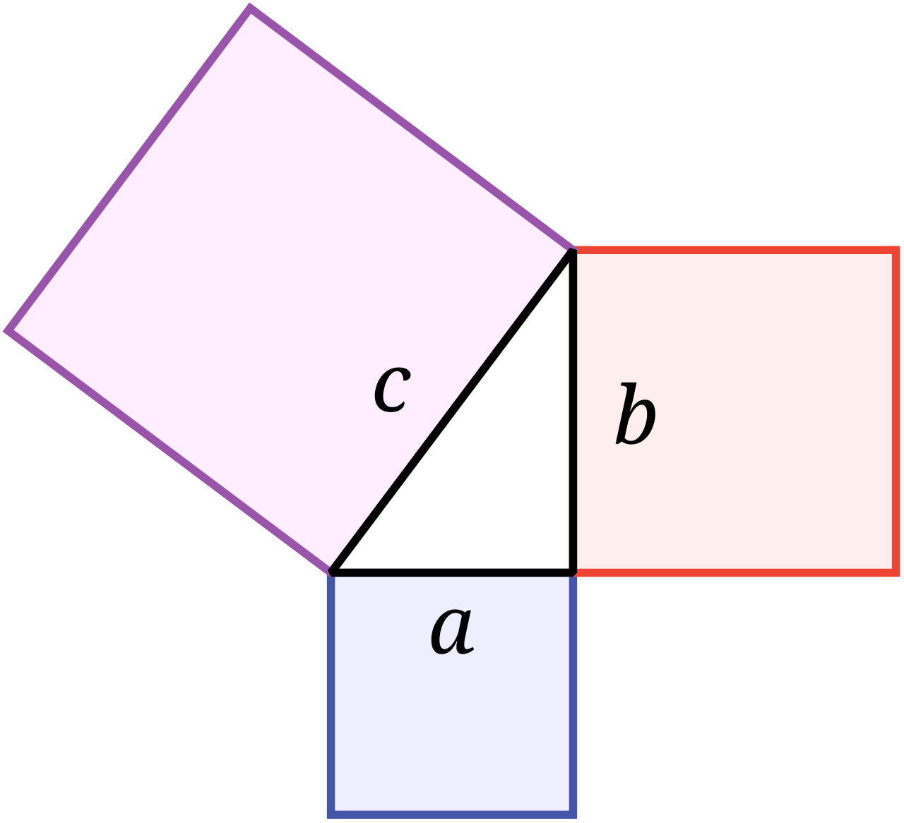

<!--toc:start-->
- [Ogólne](#ogólne)
- [Trójkąty i czworokąty](#trójkąty-i-czworokąty)
  - [Własności czworokątów](#własności-czworokątów)
    - [Trapez](#trapez)
    - [Prostokąt](#prostokąt)
    - [Kwadrat](#kwadrat)
    - [Równoległobok](#równoległobok)
    - [Romb](#romb)
- [Twierdzenie pitagorasa](#twierdzenie-pitagorasa)
- [Zastosowania twierdzenia pitagorasa](#zastosowania-twierdzenia-pitagorasa)
- [Trójkąciki o kątach charakterystycznych](#trójkąciki-o-kątach-charakterystycznych)
- [Odcinki w układzie współrzędnych](#odcinki-w-układzie-współrzędnych)
- [Dowodzenie w geometrii](#dowodzenie-w-geometrii)
<!--toc:end-->

# Ogólne
[ZPE o wszystkim](https://zpe.gov.pl/b/wlasnosci-figur-geometrycznych-na-plaszczyznie/PtWtLB2sj)
[Sprawdzian szalone liczby ze wszystkiego](https://szaloneliczby.pl/figury-geometryczne-sprawdzian-klasa-8/)
[eduelo](https://www.eduelo.pl/quizy/poziom-viii/matematyka/figury-na-plaszczyznie/)

# Trójkąty i czworokąty
[Sprawdzian szalone-liczby](https://szaloneliczby.pl/trojkaty-i-czworokaty-sprawdzian-klasa-8/)
[Pdf](http://www.sp.bieliny.pl/asp/pliki/borycka/trojkaty_i_czworokaty.pdf)

## Własności czworokątów
[Źródło](https://prezi.com/gq9xjvzq2kss/wasnosci-figur-geometrycznych/)

### Trapez
- ma co najmniej jedną parę boków równoległych;
- równoległe boki to podstawy, a pozostałe ramiona;
- suma miar kątów przy jednym ramieniu to 180 stopni;
- odcinek łączący podstawy to wysokość;
- trapez róznoramienny ma ramiona jednakowej długości;
- w trapezie prostokątnym jest co najmniej jeden kąt prosty;
- w trapezie równoramiennym kąty przy tej samej podstawie mają równe mairy, a przekątne są takiej samej długości;

### Prostokąt
- ma wszystkie kąty proste;
- jego przekątne są takiej samej długości i przecinają się w połowie;
- przeciwległe boki są równe i równoległe;
- sąsiednie boki są prostopadłe;

### Kwadrat
- jest prostokątem, który ma wszystkie boki tej samej długości;
- jego przekątne są jednakowej długości i przecinają się w połowie pod kątem prostym;
- przekątna dzieli kwadrat na dwa przystające trójkąty prostokątne;

### Równoległobok
- ma dwie pary boków równoległych;
- jego przekątne przecinają się w połowie;
- jest trapezem równoramiennym;
- jego przeciwległe boki są tej samej długości;
- suma dwóch sąsiednich kątów wynosi 180 stopni; 
- przekątna dzieli go na dwa trójkąty przystające;

### Romb
- ma wszystkie boki tej samej długości;
- jest równoległobokiem;
- jego przekątne przecinają się w połowie i pod kątem prostym;
- przeciwległe boki są równoległe;
- przekątne dzielą go na cztery przystające trójkąty prostokątne;

# Twierdzenie pitagorasa

[elegancka animacja tłumacząca](https://www.youtube.com/watch?v=vbG_YBTiN38)
[pdf](https://zs-halinow.edu.pl/wp-content/uploads/2020/04/tw.pitagorasa.pdf)
[matzoo](https://matzoo.pl/klasa8/twierdzenie-pitagorasa_71_441)
[Sprawdzian szalone liczby](https://szaloneliczby.pl/twierdzenie-pitagorasa-sprawdzian-klasa-8/)

[*Źródło*](https://pl.wikipedia.org/wiki/Twierdzenie_Pitagorasa#/media/Plik:Pythagorean.svg)

# Zastosowania twierdzenia pitagorasa
[jakaś taka dziwna strona](https://www.umiemymatematyke.pl/cwiczenia-twierdzenie-pitagorasa-zastosowanie-8-klasa)

# Trójkąciki o kątach charakterystycznych
[wyjaśnienie - szalone liczby](https://szaloneliczby.pl/trojkaty-o-katach-90-45-45-oraz-90-30-60/)
[wyjaśnienie - wyciągnięcie wzorów](https://opracowania.pl/opracowania/matematyka/trojkaty-o-katach-90-45-45-oraz-90-60-30,oid,1845)
[Sprawdzian szaloneliczby](https://szaloneliczby.pl/trojkaty-o-katach-90-45-45-oraz-90-30-60-sprawdzian-klasa-8/)
[zadania - pdf](https://pl-static.z-dn.net/files/d57/87d52e9a5610d7fec04f246da1a6613f.pdf)

# Odcinki w układzie współrzędnych
[wyjaśnienie - matemaks](https://www.matemaks.pl/dlugosc-odcinka-w-ukladzie-wspolrzednych)
[zadania - pdf](https://pl-static.z-dn.net/files/da6/64dae1592c82565afa0a1a207f558174.pdf)
[zadania z ocinków, egzamin 8 klasisty - szalone liczby](https://szaloneliczby.pl/uklad-wspolrzednych-zadania-egzamin-osmoklasisty/)

# Dowodzenie w geometrii
[jakaś prezentacja o dowodzeniu](https://www.pcdzn.edu.pl/wp-content/uploads/2018/01/dowodzenie.pdf)
[zadania - matinfuk](https://matinf-uk.pl/2025/02/10/dowodzenie-w-geometrii/)
