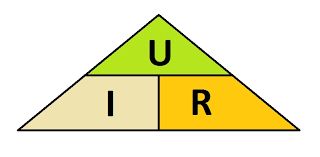

# Spis treści

<!--toc:start-->
- [Spis treści](#spis-treści)
- [Ogólne](#ogólne)
  - [Dodatkowe materiały](#dodatkowe-materiały)
- [Prąd elektryczny. Napięcie elektryczne i natężenie prądu](#prąd-elektryczny-napięcie-elektryczne-i-natężenie-prądu)
  - [Informacje](#informacje)
    - [Napięcie elektryczne](#napięcie-elektryczne)
      - [Wzory](#wzory)
    - [Natężenie prądu](#natężenie-prądu)
      - [Wzory](#wzory-1)
  - [Zadania](#zadania)
- [Pomiar natężenia prądu i napięcia elektrycznego](#pomiar-natężenia-prądu-i-napięcia-elektrycznego)
  - [Informacje](#informacje-1)
  - [Zadania](#zadania-1)
- [Opór elektryczy](#opór-elektryczy)
  - [Informacje](#informacje-2)
  - [Zadania](#zadania-2)
- [Praca i moc prądu elektrycznego](#praca-i-moc-prądu-elektrycznego)
  - [Informacje](#informacje-3)
  - [Zadania](#zadania-3)
- [Użytkowanie energii elektrycznej](#użytkowanie-energii-elektrycznej)
  - [Informacje](#informacje-4)
  - [Zadania](#zadania-4)
<!--toc:end-->

# Ogólne
## Dodatkowe materiały
- [eduelo z prądu elektrycznego](https://www.eduelo.pl/quizy/poziom-viii/fizyka/elektrostatyka-i-prad-elektryczny/)

# Prąd elektryczny. Napięcie elektryczne i natężenie prądu
## Informacje

*piramidka*

Niech:
U = Napięcie (Volty (V))
R = Rezystancja (oporność) (Omy $\Omega$)
I = Natężenie(Ampery(A))
W = Praca(Dżule(J))
Q = Ładunek(Columby(C))
P = Moc (Wolty(W))
t = Czas (Sekundy(s))

### Napięcie elektryczne

#### Wzory
$$
\begin{align}
U = R \cdot I \\
U = \frac{W}{Q} \\
U = \frac{P}{I}
\end{align}
$$

### Natężenie prądu
#### Wzory
$$
\begin{align}
I = \frac{U}{R} \\
U = \frac{Q}{t} \\
\end{align}
$$

## Zadania

# Pomiar natężenia prądu i napięcia elektrycznego
## Informacje

## Zadania

# Opór elektryczy
## Informacje

## Zadania

# Praca i moc prądu elektrycznego
## Informacje

## Zadania

# Użytkowanie energii elektrycznej
## Informacje

## Zadania
