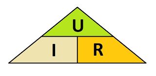

# Spis treści
<!--toc:start-->
- [Spis treści](#spis-treści)
- [Prąd elektryczny. Napięcie elektryczne i natężenie prądu](#prąd-elektryczny-napięcie-elektryczne-i-natężenie-prądu)
  - [Informacje](#informacje)
    - [Napięcie elektryczne](#napięcie-elektryczne)
      - [Wzory](#wzory)
    - [Natężenie prądu](#natężenie-prądu)
      - [Wzory](#wzory-1)
  - [Zadania](#zadania)
<!--toc:end-->

# Prąd elektryczny. Napięcie elektryczne i natężenie prądu
## Informacje

*piramidka*

*Zależność pomiędzy natężeniem, rezystancją i napięciem (prawo ohma)*

Niech:
- U = Napięcie (Volty (V))
- R = Rezystancja (oporność) (Omy $\Omega$)
- I = Natężenie(Ampery(A))
- W = Praca(Dżule(J))
- Q = Ładunek(Columby(C))
- P = Moc (Wolty(W))
- t = Czas (Sekundy(s))

### Napięcie elektryczne

#### Wzory
$$
\begin{align}
U &= R \cdot I \\
U &= \frac{W}{Q} \\
U &= \frac{P}{I}
\end{align}
$$

### Natężenie prądu
#### Wzory
$$
\begin{align}
I &= \frac{U}{R} \\
U &= \frac{Q}{t} \\
\end{align}
$$

## Zadania
- [zpe](https://zpe.gov.pl/a/prad-elektryczny-i-jego-natezenie/DpaKXq7l5)
- [zestaw zadań - pdf](http://pracazdalna.spslupno.pl/wp-content/uploads/2021/02/praca-i-moc-klasa-8.pdf)
